# orbit brand kit

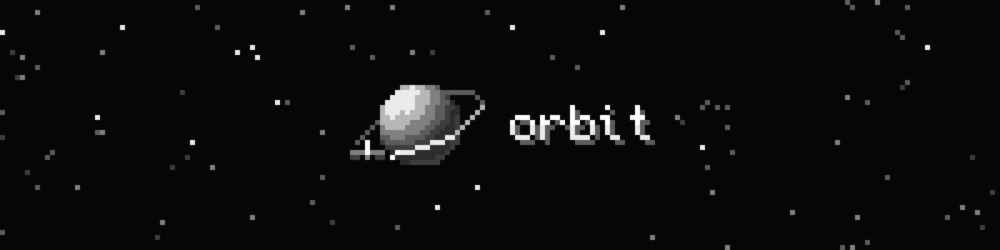

orbit's identity is **pixel art in strict grayscale**: a small planet with a satellite on a tilted
orbit, and a wordmark set in a Minecraft-style pixel font. It only uses the eight grays below.

Every image here is drawn by [`generate.swift`](generate.swift). Don't edit the PNGs by hand.
Change the script and run it again (see [Regenerating](#regenerating)).

## Logo

| | On dark | On light |
|---|---|---|
| **Mark** | 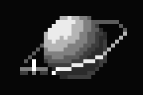 | 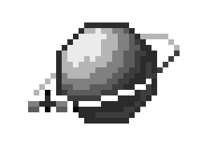 |
| **One-color mark** | 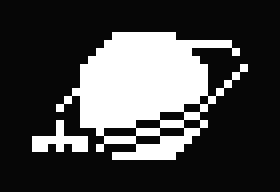 | 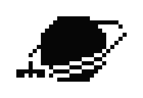 |
| **Wordmark** | 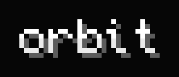 | 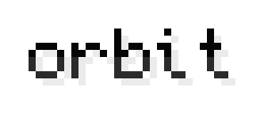 |
| **Horizontal lockup** | 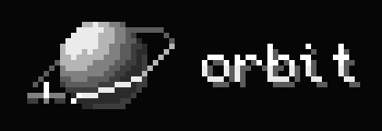 | 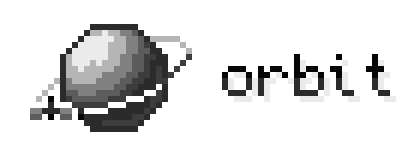 |
| **Stacked lockup** | 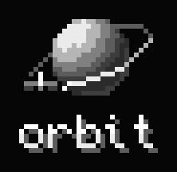 | 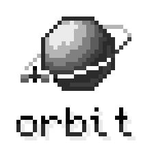 |

The previews above are tiles from [`preview/`](preview), each on the background it was made for, so they
read in both GitHub themes. The assets to actually use are in `logo/`, `wordmark/` and `lockup/`, and
they have transparent backgrounds. Use the *on dark* files on Void through Iron and the
*on light* files on Fog through White. On a mid gray, a photo or anything busy, use the one-color mark.

- **The mark** is drawn on a 32 × 32 grid. The planet is lit from the upper left. The far half of the
  orbit passes behind the planet and the near half passes in front of it. The satellite sits on the
  near-left part of the orbit.
- **The one-color mark** is a single ink with 1-pixel gaps where the orbit and the satellite pass in
  front of the planet. Use it for single-color print, embossing, stamps and template images (for
  example a menu bar or widget glyph).
- **The wordmark** is lowercase "orbit" in Monocraft, drawn on the font's own pixel grid. It is two-tone
  like Minecraft title text (the top rows are lighter) with a hard 1-pixel drop shadow down and to the
  right.
- **Lockups** put a gap of 5 art pixels between the mark and the wordmark (4 in the stacked version).
  Don't rebuild a lockup by eye. Use these files.

### Clear space and minimum size

- Keep at least **4 art pixels** of empty space around the mark, wordmark or lockup. One art pixel is
  one cell of the original grid, so at 16× that's 64 px.
- Show the mark no smaller than **32 px** (1×) and the wordmark no smaller than **29 × 8 px** (1×).
  Prefer 2× or larger. At 1× the satellite is only a few pixels.

### Scaling: whole numbers only

Pixel art falls apart when it's resampled. Always:

- scale by **whole numbers** (1×, 2×, 3×, …), never 1.5× or "fit to width";
- turn smoothing off: in SwiftUI `Image(...).interpolation(.none)`, in CSS
  `image-rendering: pixelated`, in Figma or Sketch "nearest neighbor" export;
- use **one pixel size per composition**. Don't put a 2× wordmark next to a 1× mark. Change the
  canvas instead.

### Don't

- add color, gradients, glows or smooth (anti-aliased) edges;
- rotate, skew, outline or re-shade the mark, or move the satellite;
- set the wordmark in anything but Monocraft, or change its case ("Orbit", "ORBIT");
- put the full-tone mark on mid grays (Slate or Ash), where the planet blends into the background;
- squash the wordmark into a different aspect ratio.

## Color

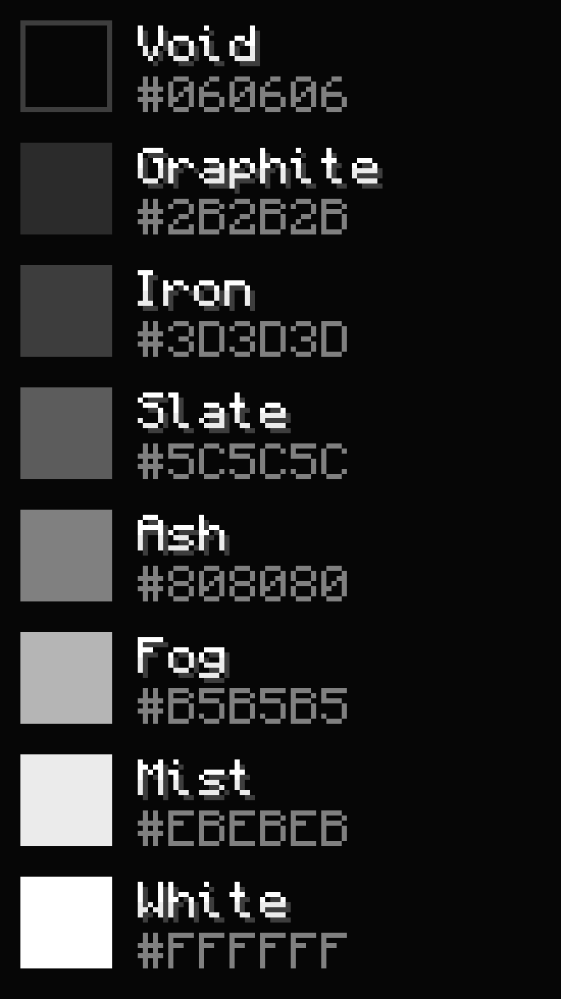

| Name | Hex | Typical use |
|---|---|---|
| Void | `#060606` | Backgrounds, outlines on dark |
| Graphite | `#2B2B2B` | Planet's dark side, text on light |
| Iron | `#3D3D3D` | Bounce light, panels |
| Slate | `#5C5C5C` | Far half of the orbit, dim stars, wordmark shadow on dark |
| Ash | `#808080` | Midtones, secondary text |
| Fog | `#B5B5B5` | Far half of the orbit on light |
| Mist | `#EBEBEB` | Highlights, wordmark shadow on light |
| White | `#FFFFFF` | Near half of the orbit, satellite, wordmark |

The brand uses no other colors. [`colors/orbit.gpl`](colors/orbit.gpl) is a GIMP palette file that
Aseprite, GIMP, Krita and most other pixel editors can load.

## Typography

- **Display:** [Monocraft](https://github.com/IdreesInc/Monocraft) by Idrees Hassan, under the
  [SIL Open Font License 1.1](fonts/OFL.txt). The TTF is in [`fonts/`](fonts). Use it only for the
  wordmark and for short display text such as headlines, labels on brand art and the palette sheet.
  Its pixels line up with screen pixels at **9 px and whole multiples of 9** (18, 27, 36, …). At
  other sizes the pixels come out uneven.
- **Interface:** the app's own UI uses the system font (SF Pro) and isn't pixelated. That keeps long
  text readable and Dynamic Type working. Pixel type is for branding, not for reading.

If you bundle Monocraft in an app or website, ship `OFL.txt` with it. The license doesn't allow selling
the font file on its own or using the name "Monocraft" for a modified version of it.

## App icon

| Default | Dark | Tinted | Light (alternate) |
|---|---|---|---|
| 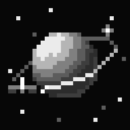 | 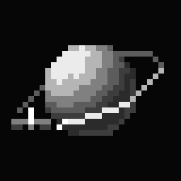 |  | 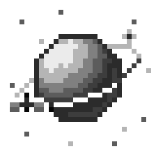 |

- `app-icon/icon-1024.png` is the single-size source image for the Xcode `AppIcon` set. It's the mark
  on Void with a sparse starfield. iOS rounds the corners, so the art keeps its margins.
- `icon-dark-1024.png` (transparent background) and `icon-tinted-1024.png` (opaque grayscale) are for
  the iOS dark and tinted appearances.
- `icon-light-1024.png` is the same mark on a white sky with dark stars. It isn't one of the iOS
  appearances. Use it as an alternate app icon or anywhere the brand sits on a light page. The default
  icon already works in light mode: iOS shows the default icon in light mode, and a dark icon on a
  light home screen is normal.
- `icon-32.png` through `icon-512.png` are whole-number enlargements for docs, websites and favicons.
  Don't make 180 px or 167 px versions by resampling; they come out blurry.

`generate.swift` also writes these into the app's `AppIcon` set (`orbit/Resources/Assets.xcassets/AppIcon.appiconset`), so re-running the script keeps the app icon in sync with the kit.

## Social

- [`social/github-social-preview.png`](social/github-social-preview.png) (1280 × 640): upload it in
  the repository's **Settings → General → Social preview**.
- [`social/readme-banner.png`](social/readme-banner.png) (1600 × 400): the header for this README and
  the project README.

## Regenerating

```bash
swift docs/brand/generate.swift
```

Run it from the repository root. It takes a few seconds and needs only Xcode's toolchain: CoreText for
the font, and CoreGraphics and ImageIO for the PNGs. The output is deterministic, even the starfield.
